<h1 align="center">Reverse Engineer Success</h1>

<p align="center">
  <b>Free, open-source research skill for <a href="https://claude.com/product/claude-code">Claude Code</a>.</b><br />
  Find out how someone really succeeds, and whether you should try something similar.
</p>

<p align="center">
  <a href="#install">Install</a> ·
  <a href="#see-what-you-get">Example</a> ·
  <a href="#how-a-report-gets-made">How it works</a> ·
  <a href="#what-makes-it-work-best">Tools</a> ·
  <a href="#faq">FAQ</a>
</p>

<p align="center">
  <a href="https://claude.com/product/claude-code"></a>
  <a href="LICENSE"></a>
  
</p>

**Reverse Engineer Success is a free research skill for Claude Code.** Give it an X profile or post. It works out what the business really is, labels how well each claim holds up, writes the blueprint, and tells you whether a similar path is worth it for you.

A viral post is a claim, and the headline often isn't the real business. The useful detail tends to be in replies, later caveats, store listings, sitemaps, public stats and the people who tried the same thing and failed.

What you get:

- **The real business.** What makes the money, how customers are found, and how the headline claim fits in.
- **A blueprint you can follow.** The steps, tools and offers, each with a label showing how far to trust it.
- **Numbers that get checked.** It pairs figures and does the arithmetic, so a claim that doesn't add up gets flagged.
- **A verdict for you.** It weighs demand, competition, economics and your goal, then gives you the smallest test to run first.
- **Every source.** A Markdown report for the full research, and a shareable page with all the links.

## See what you get

Every report opens with what the business really is, and ends with a verdict based on your goal. This example is made up, to show the format:

> **What the business really is:** The founder's "$40k solo agency" appears to be a paid-promotion business built on a large audience. The audience and paid-post labels are confirmed. The revenue and clients aren't.
>
> | Metric | Value | Status |
> |---|---|---|
> | Followers | 120K | **Confirmed** |
> | Monthly revenue | $40K | **Self-reported** |
> | Monthly costs | "Under $300" and "$750" in one post | **Conflicting** |
> | Named clients | None found | **Unknown** |
>
> **Verdict: Pursue a narrower version.** Copy the content engine and offer structure. Skip selling reach until you have an audience.
>
> **Smallest test:** 30 days, 4 long guides from real work. Pass if one guide gets bookmarks from about 1% of viewers, and you get 3 serious conversations.

## Install

You need [Claude Code](https://claude.com/product/claude-code). Python 3 is optional, and runs the bundled scripts with no packages to install.

```bash
git clone https://github.com/ferdelamad/reverse-engineer-success.git
mkdir -p ~/.claude/skills
ln -s "$(pwd)/reverse-engineer-success/skills/reverse-engineer-success" ~/.claude/skills/reverse-engineer-success
```

Then start a new Claude Code session.

**Your first report:**

```text
/reverse-engineer-success https://x.com/<handle>/status/<id>
```

Or just ask:

```text
This founder says SEO got them to $10k MRR. Is it real, and could I do something similar?
```

It asks up to three quick questions about your goal and resources, then does the research. A full run takes a while and uses a lot of tokens.

<details>
<summary><b>Update or uninstall</b></summary>
<br />

To update, run `git pull` in the cloned folder. To uninstall, remove the link:

```bash
rm ~/.claude/skills/reverse-engineer-success
```

</details>

## How a report gets made

1. **Intake.** Asks about your goal, what you bring, and any claim you want checked.
2. **Find the claims.** Reads their posts, replies and follow-ups, and dates how their story has changed.
3. **Trace ownership.** Follows public links from claims to named products and companies, and leaves the rest as Unknown.
4. **Measure what's live.** Checks public stats, pricing, sitemaps, store listings, and npm and GitHub data.
5. **Get outside evidence.** Finds competitors, failures, base rates and platform rules.
6. **Stress-test.** Asks who benefits, whether the numbers add up, and which advantages won't transfer to you.
7. **Write it up.** Saves the Markdown report and the page, with every number labeled and sourced.

<details>
<summary><b>The evidence labels</b></summary>
<br />

| Label | Meaning |
|---|---|
| **Confirmed** | Checked against a primary source or measured directly |
| **Self-reported** | Stated by the subject and not independently checked |
| **Estimate** | From third-party tools |
| **Secondary** | From someone else's summary, and not checked at the source |
| **Inferred** | Reasoned from indirect evidence |
| **Unknown** | Not established |

</details>

<details>
<summary><b>What's in each report</b></summary>
<br />

1. What the business really is
2. Step-by-step blueprint
3. Key numbers
4. What to copy and what to avoid
5. Risks and what would change this view
6. Opportunity assessment
7. Unknowns
8. Sources

The Markdown report adds an evidence log, corrections and method notes. The page is published as a private Claude artifact when that's available, and is a local HTML file otherwise.

</details>

<details>
<summary><b>The bundled scripts</b></summary>
<br />

| Script | Use |
|---|---|
| `public_signals.py` | Stats pages, pricing, sitemap sections, npm and GitHub traction |
| `site_audit.py` | Blog size, publish pace, payment and analytics signals |
| `article_audit.py` | Word count, schema, headings and links |
| `ios_catalog.py` | A developer's US App Store catalogue |
| `ios_reviews.py` | Recent low-star US App Store reviews |
| `play_listings.py` | Google Play titles, install bands and ratings |

</details>

## What makes it work best

It uses whatever you have and tells you what it couldn't check.

| Tool | What it adds |
|---|---|
| Browser access with your X login | Replies, timelines and charts. This makes the biggest difference |
| A web research tool or MCP server | Broader, faster research |
| Ahrefs, Semrush or DataForSEO | Traffic and keyword data |
| Python 3 | The bundled scripts |

**Who it's for:**

- **Builders** deciding whether a business they saw online is worth trying.
- **Founders** researching a competitor's public growth playbook.
- **Skeptics** who want to know what's behind a big claim.

## FAQ

<details>
<summary><b>Is it really free?</b></summary>
<br />

The skill is free and MIT licensed. You'll need Claude Code, and any paid data tools you choose to connect are yours to pay for.

</details>

<details>
<summary><b>Can it prove someone's revenue is real or fake?</b></summary>
<br />

Usually not. It can't see private data, so a revenue screenshot stays **Self-reported**. It can show whether the claim fits the public evidence, and flag what doesn't add up.

</details>

<details>
<summary><b>How is this different from asking Claude directly?</b></summary>
<br />

It follows a set process: replies and follow-ups first, then public records, failures and a stress test, with every claim labeled. It also gives a verdict based on your goal, not just a summary.

</details>

<details>
<summary><b>Does it only work with X?</b></summary>
<br />

X is where it's strongest. You can also give it a founder or company name, but with fewer public posts to read, expect more Unknowns.

</details>

<details>
<summary><b>Do I need API keys?</b></summary>
<br />

No. Paid SEO data tools add traffic and keyword data, but the skill works from public sources without them.

</details>

<details>
<summary><b>Is my report public?</b></summary>
<br />

No. The report is saved locally, and the Claude artifact starts private to your account. It's up to you whether to share it.

</details>

## Limits

- **Private data stays Unknown.** That includes private revenue and unnamed products.
- **Survivorship bias.** It starts from someone who looks successful. It searches for failures to offset this, but can't fully remove it.
- **It needs a public footprint.** Founders and developers leave more evidence than people whose work is private.
- **It's new.** So far it has had one full end-to-end test, so please [open an issue](https://github.com/ferdelamad/reverse-engineer-success/issues) if something goes wrong.
- **It isn't advice.** Self-reported numbers aren't audited, and reports aren't financial or legal advice.

## Responsible use

The skill studies public business activity. It collects business information only, stops on private individuals, records blocked sites as gaps instead of working around them, and doesn't submit forms without approval.

Please keep reports fair, and check claims about real people before sharing them. Follow the terms of the sites and tools you use.

## License and contributing

[MIT](LICENSE). Issues and pull requests are welcome, especially reports of where the research went wrong on real targets.
